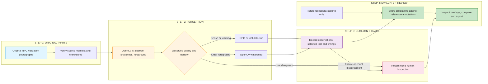
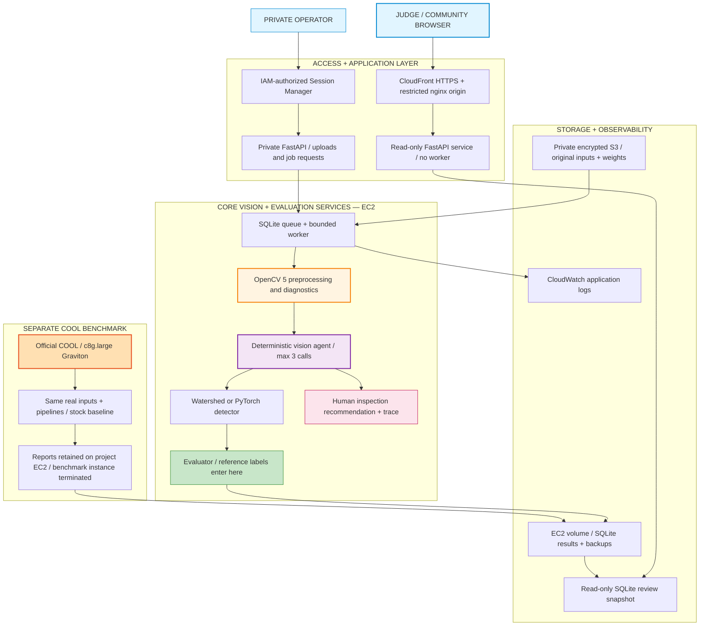

# CheckoutCheck — Real Evidence for Checkout Vision

[](https://www.python.org/)
[](https://opencv.org/)
[](https://fastapi.tiangolo.com/)
[](https://d2pt18a0j9tuil.cloudfront.net)
[](https://github.com/ankitlade12/checkoutcheck/actions/workflows/check.yml)
[](LICENSE)

> **Inspect what the camera observed, measure what the model missed, and reproduce the score.**

CheckoutCheck is an evidence workbench for engineers evaluating camera-assisted checkout systems. It brings original photographs and videos, model predictions, reference annotations and reproducible evaluation into one inspectable application.

The working hackathon POC includes five image baselines, an adaptive vision agent, an original-video lab and a separately implemented transaction evaluator. Image and video workflows have been exercised locally and on AWS. Real synchronized checkout/POS validation remains an open requirement.

**[Open the live application](https://d2pt18a0j9tuil.cloudfront.net)** · [Technical report](docs/technical-report.md)

**Hackathon:** [OpenCV 2026](https://opencv26.devpost.com/)

## Quick Highlights

- **Original-data inspection** — 24 RPC validation photos, 400 training references and six RetailAction clips in the verified installation; acquired separately from source.
- **Five measured image baselines** — connected components, watershed, SIFT reference matching, COCO Faster R-CNN and a real-photo RPC fine-tune.
- **Inspectable predictions** — separate publisher/reference and model overlays, difficulty breakdowns, counting and optional SKU metrics.
- **Original-video replay** — playback, frame seeking, publisher source timestamps and OpenCV motion/sharpness diagnostics.
- **Persistent evaluation** — SQLite-backed queue, idempotent submissions, bounded subprocesses, cancellation and restart recovery.
- **Reproducible reports** — source/model hashes, explicit exclusions, compatible-run comparison and independently recomputable JSON scores.
- **AWS execution and public review** — CPU-only EC2 worker, scoped role, encrypted inputs, CloudWatch logs, and a separate read-only CloudFront HTTPS service.
- **Agentic workflow** — OpenCV observations select the next tool; bounded calls, visible traces and human inspection recommendations.
- **Actual COOL evaluation** — official vendor runtime on Graviton; application workloads measured against stock OpenCV, with raw reports.
- **Visible limitations** — no inferred payment truth, intent detection or production-accuracy claims.

## Application Access

| Surface | Address or entry point | Access |
| --- | --- | --- |
| Live application | [Open CheckoutCheck](https://d2pt18a0j9tuil.cloudfront.net) | Inspect results, agent traces, original clips and COOL evidence |
| Local application | <http://127.0.0.1:8765> | Start `./run.command` after installation |
| Live real-data lab | [Inspect image results](https://d2pt18a0j9tuil.cloudfront.net/#perception) | Completed methods, overlays and comparisons |
| Live real-video lab | [Explore original clips](https://d2pt18a0j9tuil.cloudfront.net/#videos) | Playback, source frames and diagnostics |
| Private AWS operator tunnel | <http://127.0.0.1:8766> | Your deployed stack plus an authorized SSM tunnel |
| Health check | `/v1/health` | Database and worker readiness |
| API contracts | [`docs/contracts.md`](docs/contracts.md) | Also served at `/docs` |
| Technical report | [`docs/technical-report.md`](docs/technical-report.md) | Recorded measurements and limitations |

**Hosting ends November 10, 2026 at 6 p.m. Central.** Automatic AWS teardown is enabled for that deadline, including permanent deletion of cloud evidence without a backup. See the [cleanup scope and exceptions](infra/aws-public-review.md#automatic-teardown).

The HTTPS application exposes completed evidence through a separate read-only service. Execution and uploads remain in the private operator workspace. A fresh clone contains no datasets, weights or credentials. See the [technical report](docs/technical-report.md), [agent evaluation](docs/agentic-vision.md), [COOL benchmark](docs/cool-evaluation.md) and [public hosting guide](infra/aws-public-review.md).

## The Problem

A product box, a shelf interaction and a recorded scan describe different events. Treating them as interchangeable can produce misleading checkout claims. Engineers need to see which inputs a model received, which annotations were used only for scoring, what failed, and whether another environment can reproduce the result.

CheckoutCheck keeps image perception, source-video diagnostics and transaction evaluation separate so each measurement stays tied to the evidence that supports it.

## Architecture Overview

### High-Level Workflow



### System Architecture



Reference labels enter the evaluator after inference. This data-flow boundary does not sandbox hostile model code; arbitrary executable adapters are unsupported. See the [architecture notes](docs/architecture.md).

### Tech Stack

| Layer | Technology | Purpose |
| --- | --- | --- |
| Interface | HTML, CSS, JavaScript | Buildless review UI, overlays, replay and exports |
| API | Python 3.14, FastAPI | Validation, ingestion and job orchestration |
| Vision | OpenCV 5 | Decoding, classical regions, SIFT, ArUco and video diagnostics |
| Neural inference | PyTorch and torchvision | Faster R-CNN MobileNetV3 FPN, CPU execution |
| State | SQLite with WAL | Persistent metadata, queue and results |
| Verification | `unittest`, Node.js, Playwright | Arithmetic, API, lifecycle and browser checks |
| Deployment | Docker, CloudFormation, EC2, SSM | Private single-operator cloud execution |
| Storage and logs | Encrypted EBS, private S3, CloudWatch | Runtime data, approved inputs and operational logs |

## Product Features

### Real-data Lab

Select a method, run all registered photos, inspect detections alongside reference boxes, compare compatible runs and export the measured report. The RPC fine-tune uses 400 original training photographs for two epochs without rendering, compositing or fine-tuning augmentation. Its 24 evaluation photos are disjoint from training.

### Real-video Lab

Inspect six original RetailAction clips covering 176 encoded frames. The interface preserves the relationship between encoded playback time and publisher source time. Publisher interaction labels are shown as annotations; frame differences and sharpness are diagnostics, not scan or payment predictions.

### Transaction Evaluation

The implemented workflow accepts real MP4, recorded JSON/CSV scan events, marker/SKU mappings and reference annotations. Reviewed cases can be frozen into immutable suites, evaluated using the ArUco instrumentation baseline or imported predictions, replayed, compared and exported.

This path still needs real synchronized recordings for end-to-end validation. All products must be marked and visible for the built-in baseline. See the [capture protocol](docs/real-dataset-sources.md#real-transaction-capture-protocol) and [input/output contracts](docs/contracts.md).

## Measured Results

AWS execution on the fixed 24-photo subset, 291 reference objects; one-to-one localization matching at IoU ≥ 0.5:

| Method | Matched objects | Precision | Recall | Count MAE |
| --- | ---: | ---: | ---: | ---: |
| Foreground components | 17 / 291 | 14.17% | 5.84% | 7.46 |
| Distance watershed | 37 / 291 | 18.23% | 12.71% | 7.17 |
| SIFT references | 48 / 291 | 61.54% | 16.49% | 8.88 |
| Official COCO Faster R-CNN | 13 / 291 | 92.86% | 4.47% | 11.54 |
| RPC fine-tuned Faster R-CNN | 105 / 291 | 74.47% | 36.08% | 6.25 |

The best detector still misses **186 of 291 objects** and has no SKU head. This is a small exploratory sample, not a full-dataset benchmark or evidence of checkout reliability. Some classical results differ across macOS and Linux; [local measurements](docs/rpc-benchmark.md) and [AWS measurements](docs/technical-report.md) remain separately labeled.

## Quick Start

Requirements: Python **3.14** for the pinned application environment; Node.js **22** for software checks. The scoring-only CLI supports Python 3.11+. Verified application environments are macOS arm64 and Linux amd64.

```bash
git clone https://github.com/ankitlade12/checkoutcheck.git
cd checkoutcheck
python3.14 -m venv .venv
source .venv/bin/activate

# Linux CPU installations: install these first to avoid CUDA dependencies.
# python -m pip install torch==2.14.1 torchvision==0.29.1 --index-url https://download.pytorch.org/whl/cpu

python -m pip install -r requirements.lock
./run.command
```

Open <http://127.0.0.1:8765>. Keep the terminal open. Run one server process without `--workers` or `--reload`; the queue is designed for a single operator.

### Acquire Original Evidence

Review the [source registry and license notes](docs/real-dataset-sources.md) before downloading. Run from the repository root with the virtual environment active:

```bash
python -m checkoutcheck.rpc --count 24 --references 2
python -m checkoutcheck.learned_detector --prepare-base
python -m checkoutcheck.learned_detector --epochs 2
python -m checkoutcheck.retail_video --groups 3
python -m checkoutcheck.retail_video --analyze all
```

Downloads and training artifacts stay in ignored `private-data/`. Training refuses to overwrite an existing registered model. No synthetic images or POS records are generated. Upstream pretrained-model provenance is documented in the [benchmark notes](docs/rpc-benchmark.md).

### Judge Walkthrough

1. Open the [live application](https://d2pt18a0j9tuil.cloudfront.net/#perception) and select a completed method in **Real-data lab**.
2. Inspect matched objects, misses, precision, recall and count errors.
3. Toggle reference boxes and model predictions on an original photo.
4. Compare two completed methods on the same registered dataset.
5. Export a report and recompute its score with the CLI.
6. Open **Real-video lab**, play an original clip and seek by source frame.
7. Inspect the agent trace and COOL benchmark evidence. Read the supported conditions before interpreting any transaction result.

The public application supports inspection and exports. To launch new inference or upload inputs, use your local installation or private operator tunnel.

### Docker and AWS

```bash
docker compose up --build
```

Compose creates an empty persistent data volume and binds only to localhost. Acquire authorized originals inside that environment before running data-dependent workflows. For private cloud deployment, follow [AWS operations](infra/aws-poc-operations.md). The convenience `./start-aws.command` requires your own recorded stack outputs and the Session Manager plugin; those are deliberately absent from Git.

## Reproducible Testing

```bash
source .venv/bin/activate
python -m unittest discover -s tests -v
node --check apps/web/app.js
node --check apps/web/evidence.js
node --check apps/web/perception.js
node --check apps/web/videos.js
```

The verified original-data environment passes **71 tests**. Fresh-clone CI skips tests whose separately acquired originals or trained weights are absent; its result does not certify image/video accuracy. Temporary numeric and parser test inputs never populate the application as evidence.

Browser checks require Playwright and Chromium installed separately:

```bash
python -m pip install playwright
python -m playwright install chromium
python tests/browser_smoke.py
python tests/browser_perception.py
python tests/browser_videos.py
```

The smoke check expects an empty transaction workspace. Perception/video checks require the original-data setup above and launch actual inference. Use `CHECKOUTCHECK_URL=http://127.0.0.1:8766` for an authorized AWS tunnel, or `CHECKOUTCHECK_BROWSER` for an existing Chromium executable. See the [technical report](docs/technical-report.md#build-test-and-reproduce) for verification scope and limitations.

## Commands

| Command | Purpose |
| --- | --- |
| `./run.command` | Start the local application on port 8765 |
| `python -m checkoutcheck.rpc --count 24 --references 2` | Acquire the original RPC subset |
| `python -m checkoutcheck.learned_detector --epochs 2` | Train on installed original RPC reference photos |
| `python -m checkoutcheck.retail_video --groups 3` | Acquire six original publisher clips |
| `python -m checkoutcheck.perception --model sift-reference-v1 --output artifacts/result.json` | Run an image method; create `artifacts/` first |
| `python -m checkoutcheck.perception --verify-report artifacts/result.json` | Recompute an exported image score |
| `python -m checkoutcheck verify /path/to/bundle` | Recompute exported transaction scoring |
| `python -m checkoutcheck.release --output artifacts/release-name` | Package existing measured evidence into a new private directory |
| `./start-aws.command` | Resume your configured EC2 worker and open its private tunnel |

## Project Structure

```text
checkoutcheck/
├── apps/web/                  # Review interface, image overlays and video replay
├── checkoutcheck/             # API, evaluator, adapters, acquisition and CLI
├── tests/                     # Unit, API, original-data and browser checks
├── docs/                      # Technical report, architecture, contracts and evaluation evidence
├── infra/                     # CPU container, CloudFormation and worker installation
├── .github/workflows/         # Source-only software CI
├── requirements.lock          # Pinned application dependencies
├── compose.yaml               # Local private container
├── run.command                # Local launcher
└── start-aws.command          # Configured private-cloud launcher
```

`private-data/` and `artifacts/` are local-only directories. Credentials, databases, model weights, media, private PRDs and generated release bundles are excluded from Git.

## Configuration

| Setting | Default | Purpose |
| --- | --- | --- |
| `CHECKOUTCHECK_DATA` | `private-data/` | Private runtime storage; data acquisition commands also accept `--directory` |
| `CHECKOUTCHECK_RUNTIME` | `local_single_operator` | Deployment label, not proof that an AWS workload ran |
| `CHECKOUTCHECK_URL` | `http://127.0.0.1:8765` | Target used by browser checks and recording |
| `CHECKOUTCHECK_BROWSER` | Playwright-managed browser | Optional Chromium executable |

No LLM API key or AWS account is needed locally. Keep the operator application on loopback or behind the private SSM tunnel. Public hosting must use the separate read-only review mode described in the hosting guide.

## Roadmap and Known Limits

The release includes a public review application and a private execution workspace. Next steps are real checkout/POS evidence, stronger held-out detector evaluation, independent review and data-governance workflows, and external pilot testing. Accounts are deferred from the hackathon scope. Full community MVP acceptance remains open.

The [technical report](docs/technical-report.md) records measured results and remaining acceptance requirements. The AWS review application is published; Devpost final submission remains a separate step.

## Licensing

Project source code is available under the [MIT license](LICENSE). Dataset and model rights are separate: RPC carries noncommercial/share-alike terms, RetailAction has its own license, and pretrained dependencies retain their upstream terms. This repository does not redistribute their media or weights. See [THIRD_PARTY_NOTICES.md](THIRD_PARTY_NOTICES.md).
