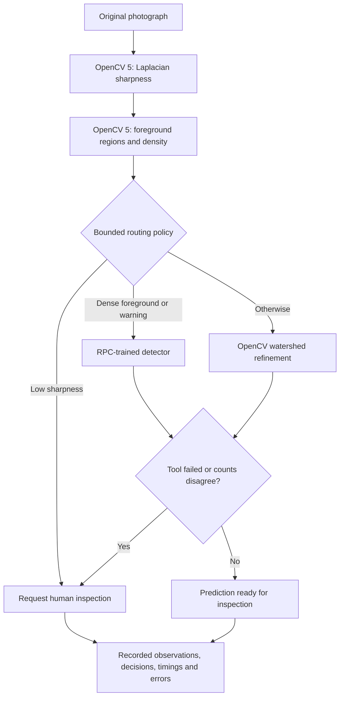

# Vision investigation agent

CheckoutCheck implements an experimental, deterministic perception–decision–action controller. It uses no LLM and makes no automatic checkout intervention. OpenCV observations select the next tool; reference annotations are used only afterward for scoring.



## Reproduce

Install the pinned environment, original RPC subset and registered trained weights as described in the main README. Run:

```sh
.venv/bin/python -m checkoutcheck.perception --model vision-agent-v1 --output artifacts/agent-evaluation.json
.venv/bin/python -m checkoutcheck.perception --verify-report artifacts/agent-evaluation.json
.venv/bin/python -m unittest discover -s tests -p 'test_agent.py'
```

The application exposes the same method in Real-data lab. Open a completed agent run, select a photograph, and inspect its perception → decision → action trace. The public judge service permits inspection; execution remains in the private operator workspace.

## Measured task evaluation

The local and personal AWS runs on October 26, 2026 produced matching detection scores and routing counts on the existing exploratory subset: 24 original photographs, 291 annotated products. AWS run: `f2c562d4b7684938b944c0ee84e13192`.

| Measure | Observed result |
|---|---:|
| Images completed / submitted | 24 / 24 |
| Neural follow-up / watershed follow-up | 18 / 6 |
| Human inspection recommended | 17 / 24 |
| Tool calls / budget violations | 72 / 0 |
| Observed follow-up tool failures | 0 |
| Matched / false positive / missed products | 94 / 53 / 197 |
| Precision / recall | 63.95% / 32.30% |
| Count MAE | 6.33 |

The trained detector alone scores 74.47% precision and 36.08% recall on these same images. The adaptive controller **does not improve detection accuracy** in this experiment. Workflow completion is distinct from detection correctness. The routing thresholds are exploratory, not calibrated on an untouched holdout; review recommendations have no independently labeled review-necessity ground truth.

## Failure handling and human control

Each trace records the tool, status, elapsed time, observed values, next tool and reason. At most three tools execute per image. A failed follow-up retains the initial observation and requests human inspection. A unit check injects a tool exception while processing an original photograph; that software check is not counted as real-world evaluation evidence. Separate policy checks cover low sharpness, dense foreground, warning and clear-background branches. No blurred or generated image dataset is introduced.

Low-quality input, failed follow-up and count disagreements route to inspection. The controller never changes a transaction, charges a customer, labels a person, or asserts theft. Reference annotations do not enter the controller. Public visitors cannot start or cancel runs, modify data, or retrieve private transaction media.
