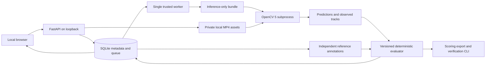

# Architecture

The evaluator has no image-processing dependency. Model inference receives only media and permitted transaction/catalog/configuration fields. The trusted subprocess does not receive the suite's reference annotations. This is an explicit data-flow boundary, not an OS security boundary against hostile model code; arbitrary executable adapters are unsupported.

Suite hashes include a digest of registered case entries, which bind video checksums, input events, preprocessing configuration, and labels. Runs use idempotency keys, immutable suite references, one sequential worker, and atomic final-result commits. A partial result keeps failed/missing cases visible and excludes them from metric denominators while reducing processing coverage.

The local UI uses buildless HTML, CSS, and JavaScript. This was chosen to keep the review client inspectable and avoid a separate frontend toolchain; it is a documented departure from the PRD's proposed React stack. Python/FastAPI handles API and orchestration; SQLite holds persistent local metadata. Large media stays outside the database and source tree.

## Login-free hackathon deployment

The user chose no application login for the hackathon. The deployed private POC uses a single EC2 host, encrypted storage, private S3, a restricted instance role, CloudWatch logs and IAM-authorized Session Manager port forwarding. Its security group has no inbound ports. The browser connects to a local forwarded address, or judges view an arranged screen share. No public application endpoint or multi-user access is provided. The stack is deployed in the personal account in us-east-1. The operator uses temporary CLI login credentials; the worker uses its scoped EC2 role. No credentials are included in source or containers.

See [deployment template](../infra/aws-poc.json) and [operations steps](../infra/aws-poc-operations.md). The CPU-only Linux/amd64 container has built and passed health checks both locally and on EC2. Actual browser, inference and backup verification are recorded separately in the AWS verification report. A static frontend alone would not demonstrate the required AWS vision workload.
