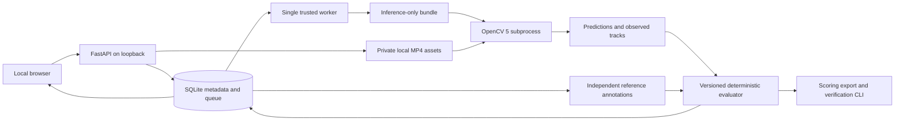

# Architecture

The evaluator has no image-processing dependency. Model inference receives only media and permitted transaction/catalog/configuration fields. The trusted subprocess does not receive the suite's reference annotations. This is an explicit data-flow boundary, not an OS security boundary against hostile model code; arbitrary executable adapters are unsupported.

Suite hashes include a digest of registered case entries, which bind video checksums, input events, preprocessing configuration, and labels. Runs use idempotency keys, immutable suite references, one sequential worker, and atomic final-result commits. A partial result keeps failed/missing cases visible and excludes them from metric denominators while reducing processing coverage.

The local UI uses buildless HTML, CSS, and JavaScript. This was chosen to keep the review client inspectable and avoid a separate frontend toolchain; it is a documented departure from the PRD's proposed React stack. Python/FastAPI handles API and orchestration; SQLite holds persistent local metadata. Large media stays outside the database and source tree.

## Login-free hackathon deployment

The private operator application uses EC2, a scoped instance role, private encrypted S3 inputs, CloudWatch logs and IAM-authorized Session Manager forwarding. A separate public review container serves completed results through CloudFront HTTPS. Only CloudFront can reach the origin port, and nginx also validates a private origin header. The public API allows only reviewed read paths plus a side-effect-free comparison operation. It has no worker and reads a consistent SQLite snapshot from a read-only volume. Private transaction media and mutation routes are blocked.

The worker keeps its original writable database. Backups, agent traces and COOL reports remain on EC2; generated results are not uploaded to S3. The temporary COOL instance ran the actual application pipelines on the official Arm runtime, transferred its reports directly over a restricted VPC connection, and was terminated after checksum verification.

See [private deployment](../infra/aws-poc.json), [public review deployment](../infra/aws-public-review.json), [agent workflow](agentic-vision.md), [COOL evaluation](cool-evaluation.md) and [technical report](technical-report.md). A static frontend alone would not demonstrate the AWS workload; actual cloud inference and benchmark evidence are available in the application.
